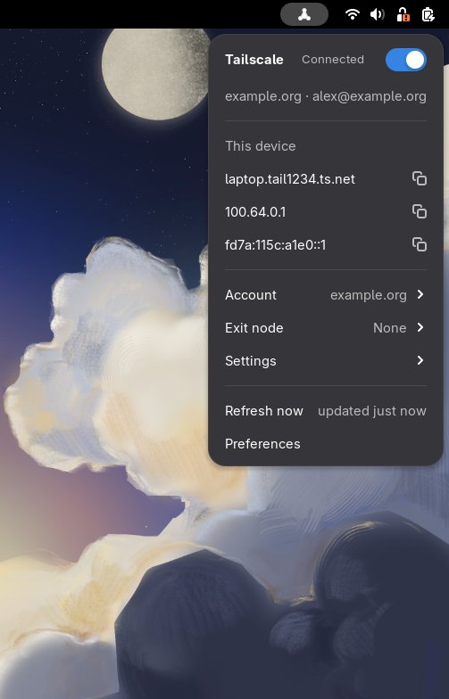
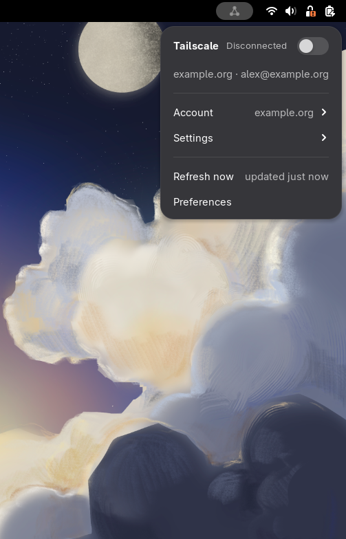
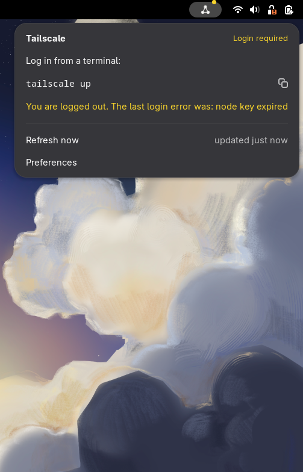
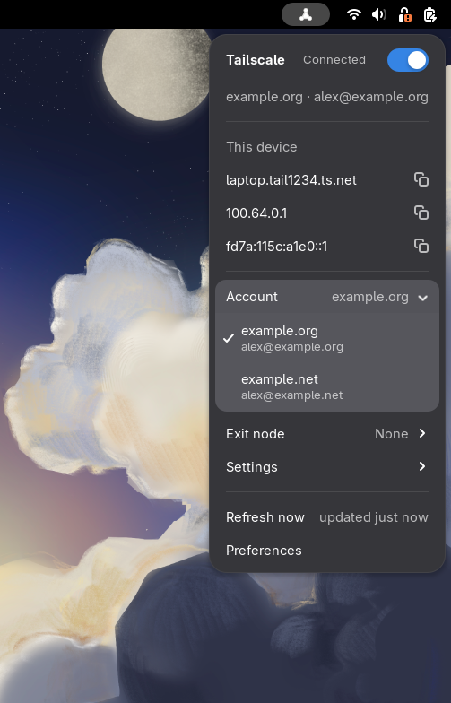
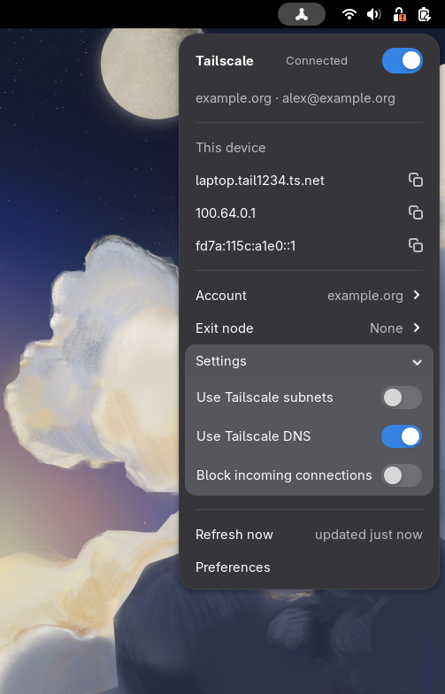
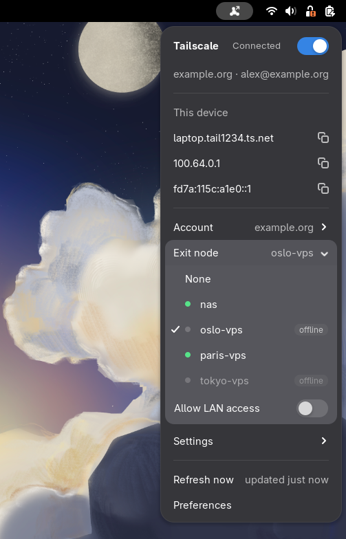

# Tailtray

A small GNOME Shell extension that shows and controls your local Tailscale node from the top bar. It
calls the `tailscale` command line, stores no credential, and never elevates privileges.

  
  
  

  
  
  

## Features

- A panel icon that shows the connection state: connected, connecting or disconnected, login or
  approval required, or unavailable.
- A switch in the menu to connect (`tailscale up`) and disconnect (`tailscale down`).
- The tailnet and login name, warnings from Tailscale (including a key about to expire), and this
  device's MagicDNS name and Tailscale addresses, each one click away from your clipboard.
- Clear explanations when Tailscale is not installed, not running, or you are not the operator,
  with the command to fix it ready to copy.
- An **Account** submenu to switch between the accounts you are already logged in to.
- An **Exit node** submenu to route your traffic through one of the tailnet's exit nodes, or back to
  none, with an **Allow LAN access** switch. The panel icon gets an arrow while one is in use.
- A **Settings** submenu with three switches: use Tailscale subnets, use Tailscale DNS, and block
  incoming connections.
- A preferences window with the refresh interval.

Other devices and notifications are coming in the next releases; see
[`docs/specs/TRY.md`](docs/specs/TRY.md).

## Requirements

- GNOME Shell 49 on Linux.
- `tailscale` and `tailscaled`, version 1.104 or later.
- To connect and disconnect from the menu, your user must be the Tailscale operator. Run once:

  ~~~sh
  sudo tailscale set --operator=$USER
  ~~~

## Install

Download `tailtray@cr0ck.github.io.shell-extension.zip` from the
[latest release](https://github.com/cr0cK/tailtray/releases/latest), then:

~~~sh
gnome-extensions install --force tailtray@cr0ck.github.io.shell-extension.zip
gnome-extensions enable tailtray@cr0ck.github.io
~~~

Log out and back in if GNOME Shell does not list the extension yet.

## Development

See [CONTRIBUTING.md](CONTRIBUTING.md). `make check` and `npm run lint` run the checks, and
`scripts/sandbox.sh --fake` tries the extension in a windowed GNOME Shell without touching your
tailnet.

## License

[MIT](LICENSE)
