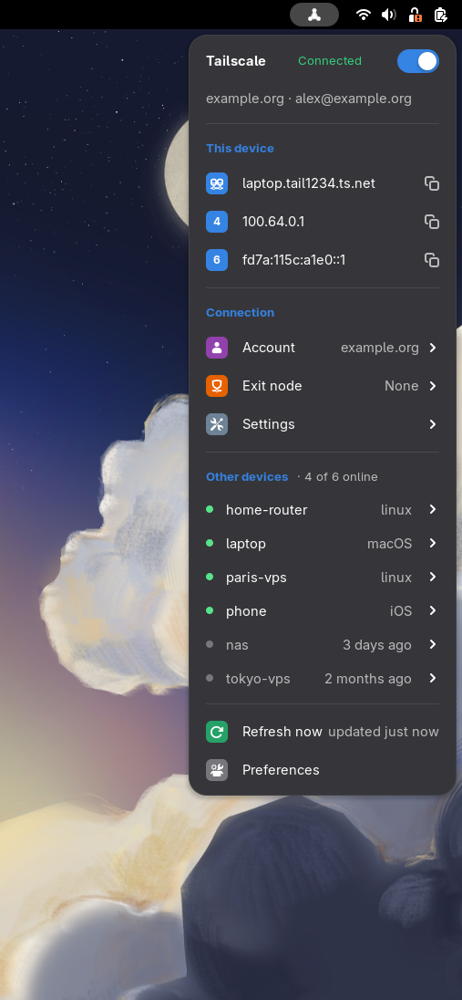
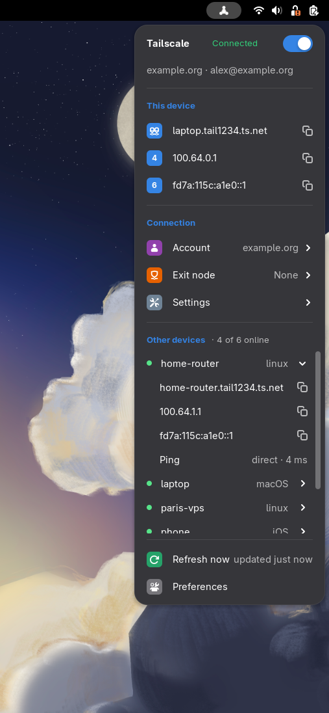
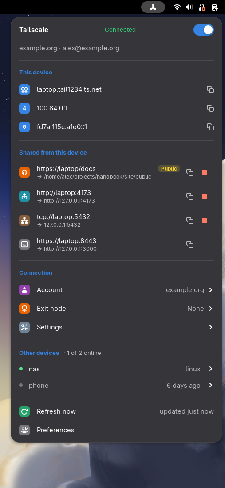

# Tailtray

A small GNOME Shell extension that shows and controls your local Tailscale node from the top bar. It
calls the `tailscale` command line, stores no credential, and never elevates privileges.

  
  
  

  
  
  

  
  
  

## Features

- A panel icon that shows the connection state: connected, connecting or disconnected, login or
  approval required, or unavailable.
- A switch in the menu to connect (`tailscale up`) and disconnect (`tailscale down`).
- The tailnet and login name, warnings from Tailscale (including a key about to expire), and this
  device's MagicDNS name and Tailscale addresses, each one click away from your clipboard.
- Clear explanations when Tailscale is not installed, not running, or you are not the operator,
  with the command to fix it ready to copy.
- An **Account** submenu to switch between the accounts you are already logged in to.
- An **Exit node** submenu to route your traffic through one of the tailnet's exit nodes, or back to
  none, with an **Allow LAN access** switch. The panel icon gets an arrow while one is in use.
- A **Settings** submenu with three switches: use Tailscale subnets, use Tailscale DNS, and block
  incoming connections.
- A **Shared from this device** section with what Tailscale Serve and Funnel share from this
  device: one row per URL or TCP port with its local target, and a **Public** mark on what Funnel
  opens to the internet. A click copies the share's URL; its stop button stops the share (shares
  started in a terminal without `--bg` have none, and Tailtray never starts or changes a share).
- A colored menu: colored tiles on the rows, accent-colored captions, and a green status in
  Connected, in the dark and the light Shell styles.
- The other devices of the tailnet, online first, in a scrolling list. Each one expands to its name
  and addresses, each one click away from your clipboard, and a **Ping** that shows whether the
  device answers directly, through a relay, or not at all.
- Notifications when the connection is lost, a login is required, the exit node in use goes
  offline, or this device's key is about to expire.
- A preferences window with the refresh interval and a switch for the notifications.

## Requirements

- GNOME Shell 49 or 50 on Linux.
- `tailscale` and `tailscaled`, version 1.104 or later.
- To connect and disconnect, and to stop a share, from the menu, your user must be the Tailscale
  operator. Run once:

  ~~~sh
  sudo tailscale set --operator=$USER
  ~~~

## Install

Download the zip of the [latest release](https://github.com/cr0cK/tailtray/releases/latest) and
install it:

~~~sh
curl -fsSLo /tmp/tailtray.zip https://github.com/cr0cK/tailtray/releases/latest/download/tailtray@cr0ck.github.io.shell-extension.zip
gnome-extensions install --force /tmp/tailtray.zip
~~~

The same commands update an existing install. For a specific version, replace `latest/download`
with `download/vX.Y.Z`.

To install from a checkout instead, run `make install` from the repository root.

GNOME Shell must reload its extension list before you enable a newly installed extension: log out
and back in. Then enable Tailtray:

~~~sh
gnome-extensions enable tailtray@cr0ck.github.io
~~~

## Development

See [CONTRIBUTING.md](CONTRIBUTING.md). `make check` and `npm run lint` run the checks, and
`scripts/sandbox.sh --fake` tries the extension in a windowed GNOME Shell without touching your
tailnet.

## License

[MIT](LICENSE)
